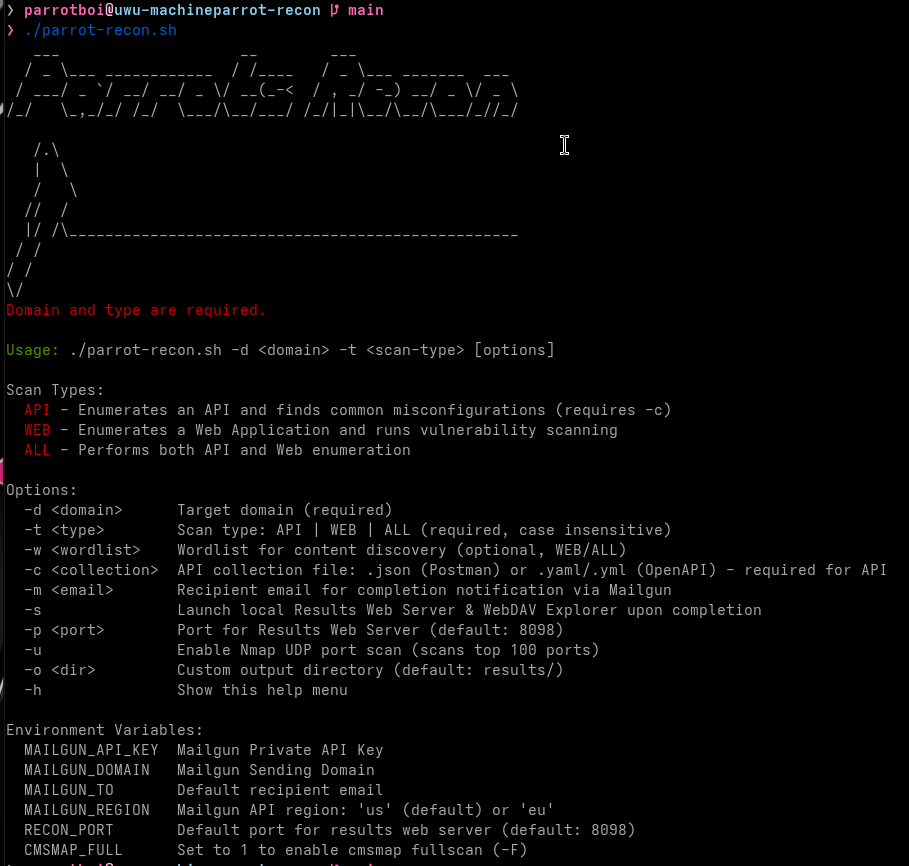

# Parrot Recon

A recon automation script that chains a stack of enumeration and vulnerability
scanners into a single run and drops everything into `results/`.

> **Warning**
> This tool is loud. It is built for bug bounties, not for engagements with a
> blue team watching. **Only point it at targets you are authorised to test.**
> The author is not responsible for what you do with it.



---

## Install

```bash
git clone https://github.com/parrotassassin15/parrot-recon.git
cd parrot-recon
sudo chmod +x install-archlinux.sh   # or install-debian.sh
sudo ./install-archlinux.sh
```

The installer pulls the package-manager tools, installs the Go helpers, clones
the bundled third-party tools into `tools/`, and builds `headi`.

## Usage

```bash
sudo ./parrot-recon.sh -d <domain> -t <scan-type> [options]
```

Root is required — several scanners (nmap's service/script scans, cmsmap's data
files) will not run without it.

### Command-Line Flags

| Flag | Description |
|------|-------------|
| `-d` | Target domain. **Required.** |
| `-t` | Scan type: `API`, `WEB`, or `ALL`. Case insensitive. **Required.** |
| `-w` | Wordlist for content discovery. Optional, used by `WEB`/`ALL`. |
| `-c` | API collection file — Postman `.json` or OpenAPI `.yaml`/`.yml`. **Required for `API`.** |
| `-m` | Recipient email address for completion notification via Mailgun. |
| `-s` | Automatically start the local results web server & WebDAV explorer upon completion. |
| `-p` | Port for the results web server (default: `8098`). |
| `-u` | Enable Nmap UDP port scan (scans top 100 ports). |
| `-o` | Custom output results directory (default: `results/`). |
| `-h` | Show help menu. |

### Environment Variables

| Variable | Description |
|----------|-------------|
| `MAILGUN_API_KEY` | Mailgun Private API Key for email notifications. |
| `MAILGUN_DOMAIN` | Mailgun sending domain (e.g. `mg.yourdomain.com`). |
| `MAILGUN_TO` | Default recipient email address (if `-m` is omitted). |
| `MAILGUN_FROM` | Custom sender address (default: `Parrot Recon <recon@<domain>>`). |
| `MAILGUN_REGION` | Mailgun API region: `us` (default) or `eu`. |
| `RECON_PORT` | Default listening port for results server (default: `8098`). |
| `CMSMAP_FULL` | Set to `1` to enable cmsmap full scan mode (`-F`). |
| `DORK_DELAY` | Sleep delay in seconds between OSINT dorking requests. |

### Scan types

**`WEB`** — website enumeration and vulnerability scanning:

- SQL error probe (`tools/main.go`)
- Search-engine dorking (`tools/dork.sh`)
- Nmap TCP service/script scan (and optional UDP scan with `-u`)
- WAF / IDS / IPS detection (wafw00f)
- Subdomain enumeration (`tools/subenum.sh` — certspotter, crt.sh, hackertarget,
  rapiddns, plus subfinder/sublist3r when installed)
- Subdomain takeover detection (`subzy` against discovered subdomains)
- Nikto web vulnerability scan
- CMS enumeration (cmsmap)
- SSL/TLS scans — full, Heartbleed, ROBOT (sslyze)
- Nuclei template scan
- Security headers check (`tools/shcheck.py`)
- CORS misconfiguration scan (`tools/cors_scanner.py`)
- HTTP header injection (headi)
- Content discovery — only when `-w` is given (ffuf, falling back to dirsearch)
- Executive summary generation (`<domain>-summary.md` and HTML dashboard)

**`API`** — API enumeration from a collection file:

- Extracts absolute URLs from the Postman/OpenAPI collection
- Nmap `--script=vuln` against each unique host on 443
- Nikto against each unique host
- Unauthenticated-access check on every URL (flags any endpoint returning 200)

**`ALL`** — runs `API` then `WEB`. If `-c` is omitted, the API portion is
skipped with a warning and the web scan still runs.

### Examples

```bash
# Web scan
sudo ./parrot-recon.sh -d example.com -t WEB

# Web scan with content discovery
sudo ./parrot-recon.sh -d example.com -t WEB -w /usr/share/wordlists/dirb/common.txt

# Web scan with UDP port scan and auto-launching local web results server
sudo ./parrot-recon.sh -d example.com -t WEB -u -s

# API scan from a Postman collection
sudo ./parrot-recon.sh -d example.com -t API -c collections/example.postman.json

# Full scan with Mailgun email alert upon completion
export MAILGUN_API_KEY="key-xxxxxxxxxxxxxx"
export MAILGUN_DOMAIN="mg.example.com"
sudo -E ./parrot-recon.sh -d example.com -t ALL -c collections/example.postman.json -m security@example.com -s
```

## Results Dashboard & WebDAV

Parrot Recon includes a built-in results web server and WebDAV explorer.

To launch the server standalone at any time:
```bash
python3 webdav/serve_results.py -p 8098 -d results/
```
Or pass the `-s` flag to `parrot-recon.sh` to open it automatically at the end of a scan.

- **Web Dashboard (`http://127.0.0.1:8098/`)**: Dark-mode cyber dashboard displaying target metrics, findings summary, file sizes, in-browser artifact previews, and downloads.
- **REST JSON Feed (`http://127.0.0.1:8098/api/files`)**: Programmatic JSON feed of all scan results and findings.
- **WebDAV Mounting**: Directly mountable in Linux (`davfs2`, Nautilus), macOS Finder (`Connect to Server`), or Windows Explorer (`Map Network Drive`).

## Output

Everything lands in `results/`, named after the target:

```
results/
├── <domain>-summary.md                  Executive Markdown summary report
├── <domain>-summary.html                Executive HTML summary dashboard
├── <domain>-tcp-scan.{nmap,gnmap,xml}   Nmap TCP scan
├── <domain>-udp-scan.{nmap,gnmap,xml}   Nmap UDP scan (when -u is passed)
├── <domain>-dork.txt                    Dork report
├── <domain>-dork-urls.txt               Bare URL list from the dork
├── <domain>-sqlerror-probe.txt          SQL error probe
├── <domain>-sslyze-{regular,heartbleed,robot}.txt
├── <domain>-shcheck.txt                 Security headers
├── <domain>-cors.csv                    CORS findings
├── <domain>-content-discovery.json      ffuf (only with -w)
├── <domain>-api-urls.txt                URLs pulled from the collection
├── <domain>-api-authcheck.txt           Unauthenticated-access results
├── nikto-<domain>.txt
├── nikto-api-<host>.txt
├── nmap-api-vuln-<host>.{nmap,gnmap,xml}
├── nuclei-<domain>.txt
├── subdomains-<domain>.txt
├── takeover-<domain>.txt                Subdomain takeover findings (subzy)
├── wafw00f-<domain>.txt
├── cmsenum-<domain>.txt
└── headi-<domain>.txt
```

A run prints a summary of any skipped or failed steps at the end and exits
non-zero if anything failed, so it can be chained in CI.

## Behaviour notes

- **Automatic permission fix:** When run via `sudo`, Parrot Recon automatically
  reassigns ownership of `results/` to the non-root `$SUDO_USER` so results are
  immediately readable and editable without root intervention.
- **A missing tool skips its step**, it does not kill the run. The step is
  listed under "Skipped" in the closing summary.
- **A failing tool is reported, not hidden.** `Saved To:` is only printed when
  the step actually succeeded.
- **The scheme is resolved once** (https, falling back to http) and reused for
  every step, instead of running each tool twice and hoping one sticks.
- **The dork queries Mojeek and DuckDuckGo**, not Google — Google now serves
  lynx a JS wall and returns nothing. If an engine rate-limits the run, the
  script says so rather than silently reporting zero results. Raise the gap
  between queries with `DORK_DELAY=<seconds>`.
- **Subdomain enumeration aggregates several sources** instead of trusting
  sublist3r alone. Most of sublist3r's engines are dead (Baidu/Yahoo/Ask return
  nothing, DNSdumpster crashes, VirusTotal blocks), and it writes no file at all
  when it finds nothing. `tools/subenum.sh` merges every source that answers and
  exits non-zero only when *all* of them fail.
- **cmsmap does not use `-F`.** cmsmap's own help calls fullscan
  *"False positives and slow!"*, and it was the step that stalled long runs.
  Set `CMSMAP_FULL=1` to opt back in.

## Requirements / gotchas

- **nikto needs the `XML::Writer` perl module** or it refuses to start, even
  for plain-text output. The installers pull it in (`perl-xml-writer` on Arch,
  `libxml-writer-perl` on Debian).
- **cmsmap writes to its own data directory** under `site-packages` — it needs
  real root, which is why the script requires it.
- **`results/` must be writable.** The script validates directory permissions
  up front.
- Postman `{{baseUrl}}` template variables cannot be resolved and are filtered
  out of the extracted URL list.

---

## Roadmap

### Phase 1: Completed & Integrated
- [x] **Completion email via Mailgun** (`-m <email>` or `MAILGUN_TO`, with executive stats & report attachments).
- [x] **Local web server & WebDAV explorer** (`-s` flag, `webdav/serve_results.py` with dark-mode web preview & JSON API).
- [x] **Consolidated executive summary generation** (`<domain>-summary.md` and HTML dashboard).
- [x] **UDP Port Scanning option** (`-u` flag for top 100 UDP services).
- [x] **Subdomain takeover detection** (`subzy` integrated against enumerated subdomains).
- [x] **Automatic `$SUDO_USER` file ownership fixing** (no more root-locked results files).
- [x] **Domain format sanitizer** (protects against command/shell injection).

### Phase 2: Vulnerability Engine Expansion (Near-Term)
- [ ] **OWASP automated attack suite toggles**:
  - Open Redirect & CRLF injection via `tools/Injectus.py`.
  - Automated CSRF vulnerability testing via `tools/XSRFProbe`.
  - Path traversal and local file inclusion via `tools/FDsploit`.
  - JWT token enumeration and algorithm confusion checks via `tools/jwt_tool.py`.
- [ ] **Multi-channel alerting webhooks**:
  - Slack, Discord, Microsoft Teams, and Telegram webhook dispatchers.
- [ ] **Parallel stage execution**:
  - Concurrent OSINT / DNS enumeration while port scanning executes in background.
- [ ] **Custom HTTP configurations**:
  - Support for custom session cookies, authorization headers (`-H`), and SOCKS5/HTTP proxies (`-x`).

### Phase 3: Platform Architecture & Continuous Recon (Long-Term)
- [ ] **Containerization**: Official Docker and OCI container images with pre-built tool dependencies.
- [ ] **Continuous Recon & Diff Engine**: Historical scan comparison engine that alerts on newly opened ports or freshly registered subdomains.
- [ ] **Centralized Database & Daemon**: Centralized PostgreSQL / SQLite backend for tracking multi-target bug bounty attack surfaces.
